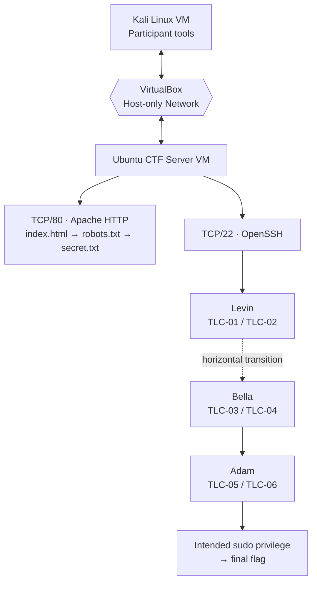

<<<<<<< HEAD
# The Last Clue — Architecture & Design

<p align="center">
  <strong>A Story-Driven, VM-Based Capture The Flag (CTF)</strong><br>
  <em>IE3132 Penetration Testing · Assignment 02</em>
</p>

<p align="center">
  
  
  
  
</p>

> **Document scope:** This README describes the intended architecture and challenge design of *The Last Clue*. Example IP addresses are illustrative. Update the document to match the actual implementation before claiming that any component has been deployed or tested.

---

## Table of Contents

- [1. Project Overview](#1-project-overview)
- [2. Scenario](#2-scenario)
- [3. Design Goals](#3-design-goals)
- [4. System Architecture](#4-system-architecture)
- [5. Network Design](#5-network-design)
- [6. Challenge Flow](#6-challenge-flow)
- [7. Challenge Design](#7-challenge-design)
- [8. Security Design](#8-security-design)
- [9. Technology Stack](#9-technology-stack)
- [10. Deployment and Validation Boundaries](#10-deployment-and-validation-boundaries)
- [11. Repository Layout](#11-repository-layout)
- [12. Design Status](#12-design-status)

## 1. Project Overview

**The Last Clue** is a story-driven Capture The Flag (CTF) project designed to provide hands-on practice in penetration testing and cybersecurity investigation. Participants follow a sequence of digital clues across six stages, progressing from basic reconnaissance to an integrated final challenge.

The intended platform uses two virtual machines in Oracle VirtualBox:

- **Ubuntu Server VM:** CTF server hosting the Apache entry point, SSH service, challenge resources, CTF accounts, and digital evidence.
- **Kali Linux VM:** participant environment for reconnaissance, analysis, scripting, and authorized challenge interaction.

The design uses a **Host-only virtual network** to keep the lab separate from public and institutional networks. Docker and containers are not part of this design.

## 2. Scenario

Three siblings—**Levin, Bella, and Adam**—are connected to a family mystery involving their mother's unexplained death. Their father's clues lead the participant through digital artifacts, user accounts, programming, cryptography, and forensic evidence.

The participant begins by investigating a web server and follows the clues from Levin to Bella and then Adam. The final stage combines evidence gathered earlier and ends with an intentionally configured, authorized privilege-escalation challenge inside the CTF.

## 3. Design Goals

- Provide six connected and progressively more difficult challenges.
- Cover multiple cybersecurity domains through practical tasks.
- Encourage information gathering and justified tool selection.
- Include at least one programming or solver task.
- Keep all testing within a dedicated, isolated lab.
- Provide a repeatable deployment, verification, and reset process.
- Ensure each stage follows an intended solution path rather than a trivial shortcut.

## 4. System Architecture

```text
                         PHYSICAL HOST
                 +--------------------------------+
                 |            VirtualBox          |
                 |                                |
                 |  +--------------------------+  |
                 |  | KALI LINUX VM            |  |
                 |  | Participant / Tester     |  |
                 |  |                          |  |
                 |  | Nmap, Browser, SSH       |  |
                 |  | Python, ExifTool,        |  |
                 |  | forensic analysis tools  |  |
                 |  +------------+-------------+  |
                 |               |                |
                 |               |                |
                 |        HOST-ONLY NETWORK       |
                 |               |                |
                 |  +------------v-------------+  |
                 |  | UBUNTU SERVER VM          |  |
                 |  | The Last Clue CTF Host    |  |
                 |  |                          |  |
                 |  | Apache HTTP — TCP/80     |  |
                 |  | OpenSSH — TCP/22         |  |
                 |  | CTF accounts and files   |  |
                 |  | Challenge evidence       |  |
                 |  +--------------------------+  |
                 +--------------------------------+
```

### Component responsibilities

| Component | Responsibility |
|---|---|
| VirtualBox host | Runs both virtual machines and provides the virtual network |
| Ubuntu Server | Hosts the CTF entry point, SSH access, challenge data, and evidence |
| Kali Linux | Provides the participant's tools and testing workspace |
| Host-only network | Provides isolated communication between the lab VMs and the host |
| Apache TCP/80 | Serves the initial web clue for TLC-01 |
| OpenSSH TCP/22 | Provides intended remote access for the account-based stages |

### Example VM addressing

These addresses are **examples only**. Replace them with the addresses configured in the actual lab.

| Node | Example address |
|---|---|
| Ubuntu CTF server | `192.168.56.10/24` |
| Kali participant VM | `192.168.56.20/24` |
| Example Host-only subnet | `192.168.56.0/24` |

The selected subnet must not conflict with an existing LAN, VPN, or virtual network.

## 5. Network Design

The intended network boundary is a VirtualBox Host-only network. Both VMs attach to the same Host-only network so Kali can access the CTF server without placing the challenge server directly on a public network.

### Intended exposed services

| Service | Port | Purpose |
|---|---:|---|
| Apache HTTP | TCP/80 | Initial web reconnaissance and clue discovery |
| OpenSSH | TCP/22 | Authorized access to CTF user accounts |

The intended exposed services are TCP/22 and TCP/80. Actual listening ports must be checked during implementation; do not assume no other service is running.

### Network security principles

- Keep the demonstration environment isolated.
- Avoid unrestricted bridged networking during the CTF demonstration.
- Use only CTF-specific accounts, credentials, keys, and evidence.
- Restrict firewall rules to the lab network or interface where practical.
- Investigate any unexpected listening service before assessment.
- Use temporary, controlled Internet access only if needed for updates, then disconnect it before isolated testing.

## 6. Challenge Flow

```text
                 +------------------------------+
                 | TLC-01: The Father's         |
                 | First Trace                  |
                 | Apache / robots.txt / clue   |
                 +---------------+--------------+
                                 |
                                 v
                 +------------------------------+
                 | TLC-02: Levin's Photograph   |
                 | Digital clue investigation   |
                 +---------------+--------------+
                                 |
                                 v
                 +------------------------------+
                 | TLC-03: Bella's Scripted Lock|
                 | Standalone Python challenge  |
                 +---------------+--------------+
                                 |
                                 v
                 +------------------------------+
                 | TLC-04: Bella's Ciphered Note|
                 | Cryptographic analysis       |
                 +---------------+--------------+
                                 |
                                 v
                 +------------------------------+
                 | TLC-05: Adam's Deleted        |
                 | Timeline                     |
                 | Digital forensics / PCAP     |
                 +---------------+--------------+
                                 |
                                 v
                 +------------------------------+
                 | TLC-06: The Last Transmission|
                 | Evidence correlation and     |
                 | authorized privilege         |
                 | escalation                   |
                 +---------------+--------------+
                                 |
                                 v
                         +---------------+
                         |  FINAL FLAG   |
                         +---------------+
```

## 7. Challenge Design

| Stage | Name | Primary domain | Intended learning activity |
|---|---|---|---|
| TLC-01 | The Father's First Trace | Web reconnaissance | Inspect the Apache entry point, discover `robots.txt`, and follow the intended clue |
| TLC-02 | Levin's Photograph | Information gathering / metadata | Investigate the provided photograph or image artifact for the next clue |
| TLC-03 | Bella's Scripted Lock | Programming and scripting | Analyze and solve a standalone Python logic/automation challenge |
| TLC-04 | Bella's Ciphered Note | Cryptography | Analyze the implemented cipher and recover the intended information |
| TLC-05 | Adam's Deleted Timeline | Digital forensics and networking | Investigate supplied forensic artifacts and packet-capture evidence |
| TLC-06 | The Last Transmission | Integrated investigation / Linux security | Correlate earlier evidence and complete the deliberately configured final CTF privilege-escalation task |

### Progression

The intended difficulty progression is:

- **Stages 1–2:** Easy
- **Stages 3–4:** Moderate
- **Stage 5:** Moderate–Hard
- **Stage 6:** Hard — capstone

The final challenge should depend on evidence collected earlier. Test every stage to ensure the intended route works and obvious unintended shortcuts do not bypass the challenge.

### Account movement and privilege escalation

The design distinguishes two concepts:

- **Horizontal user transition:** moving from Levin's account to Bella's account at the same general privilege level.
- **Vertical privilege escalation:** using the intentionally configured CTF privilege in the final Adam stage to access a higher privilege level.

The final sudo configuration must be narrow and specific to the challenge. Do not grant broad unrestricted sudo privileges as a shortcut.

## 8. Security Design

| Control | Design intention |
|---|---|
| Virtual network isolation | Keep testing within the authorized lab |
| Limited exposed services | Intend to expose only TCP/22 and TCP/80 on the Ubuntu CTF server |
| CTF-only identities | Avoid real or reused credentials |
| Least privilege | Give each challenge account only the access required for its stage |
| File permissions | Keep restricted flags, private keys, and instructor-only material inaccessible to participants until intended |
| Logging | Retain relevant service and test logs for troubleshooting and demonstration |
| Reset/recovery | Restore a documented initial state between attempts |
| Validation | Verify flags using the implemented platform mechanism or a documented manual process |

These are design requirements, not evidence that each control is already implemented. Record the actual configuration and test results separately.

## 9. Technology Stack

| Technology | Planned purpose |
|---|---|
| Oracle VirtualBox | Virtual machine platform |
| Ubuntu Server | CTF server and evidence host |
| Kali Linux | Participant/testing environment |
| Apache HTTP Server | Stage 1 web entry point |
| OpenSSH | Intended remote access for CTF accounts |
| Python 3 | Standalone programming challenge and optional helper scripts |
| Nmap | Authorized service discovery and verification |
| `curl` / web browser | HTTP inspection |
| ExifTool | Image metadata investigation, if used in TLC-02 |
| Wireshark / `tshark` | PCAP investigation, if used in TLC-05 |
| Shell scripts | Platform setup, verification, or reset automation |

Tools should be listed as implemented only after they have been installed or used in the actual environment.

## 10. Deployment and Validation Boundaries

This README describes architecture and design; it is not proof of a completed deployment. Before assessment, verify and document:

1. Both VMs boot and use the intended Host-only network.
2. The actual IP addresses and interface names.
3. Apache and SSH service status.
4. The actual listening ports and firewall rules.
5. Reachability from Kali to the Ubuntu server.
6. All six challenge paths and their intended solutions.
7. Flag validation behavior for valid and invalid submissions.
8. The reset/recovery procedure.
9. Any deviations from the approved Assignment 01 design and their technical justification.

## 11. Repository Layout

A suggested repository structure is:

```text
The-Last-Clue/
├── README.md
├── docs/
│   ├── architecture.txt
│   ├── network-design.md
│   ├── installation-guide.md
│   ├── reset-recovery.md
│   ├── testing-checklist.md
│   └── screenshots/
├── deployment/
│   ├── ubuntu/
│   │   ├── setup.sh
│   │   ├── configure-firewall.sh
│   │   └── verify-services.sh
│   └── kali/
│       └── participant-setup.md
├── scripts/
├── challenges/
│   ├── TLC-01-fathers-first-trace/
│   ├── TLC-02-levins-photograph/
│   ├── TLC-03-bellas-scripted-lock/
│   ├── TLC-04-bellas-ciphered-note/
│   ├── TLC-05-adams-deleted-timeline/
│   └── TLC-06-last-transmission/
└── evidence/
    └── test-results.md
```

This layout is a recommendation. Keep only files that exist and are appropriate to distribute. Do not commit passwords, private keys, personal data, or instructor-only solutions to a public repository.

## 12. Design Status

Complete this table with verified information before submission.

| Item | Status / record |
|---|---|
| Ubuntu version | `REPLACE_WITH_VERIFIED_VERSION` |
| Kali version | `REPLACE_WITH_VERIFIED_VERSION` |
| VirtualBox version | `REPLACE_WITH_VERIFIED_VERSION` |
| Ubuntu Host-only IP | `REPLACE_WITH_ACTUAL_IP` |
| Kali Host-only IP | `REPLACE_WITH_ACTUAL_IP` |
| Actual listening ports | `REPLACE_WITH_VERIFIED_RESULTS` |
| Flag validation method | `REPLACE_WITH_IMPLEMENTED_METHOD` |
| Reset/recovery method | `REPLACE_WITH_TESTED_METHOD` |
| End-to-end test date | `REPLACE_WITH_DATE` |
| Known limitations | `DOCUMENT_UNRESOLVED_ISSUES` |

---

## Safety Disclaimer

This project is intended for authorized cybersecurity education in a controlled lab. Run scans and tests only against the designated CTF environment. Do not target public, institutional, or third-party systems without explicit authorization.
=======
<div align="center">

# 🕵️ The Last Clue
### A Multi-User Cyber Investigation — VM-Based Capture the Flag (CTF)

**Six stages. Three accounts. One hidden truth.**

[](#-lab-architecture)
[](#-technology-stack)
[](#-technology-stack)
[](#-the-six-stages)
[](#-learning-objectives)
[](#-networking--isolation)

*A fictional, isolated lab for learning reconnaissance, Linux enumeration, scripting, cryptography, digital forensics, networking, and authorized privilege escalation.*

</div>

---

## 📖 The Story

Three siblings—**Levin, Bella, and Adam**—are connected by a family mystery: their mother died under unexplained circumstances. Their father believed the truth was hidden in a trail of digital evidence distributed across the family's records.

Your investigation starts with a small Apache website. A discovery in `robots.txt` points you toward `secret.txt`, where a **CTF-only credential** leads to Levin. Each account contains a new piece of the story. You must investigate Linux files, move horizontally from Levin to Bella, solve a standalone Python challenge, decode Bella's note, and reconstruct Adam's deleted timeline from forensic and network evidence.

The final stage brings the clues together. Inside this deliberately vulnerable training environment, you inspect Adam's explicitly configured `sudo` privilege and complete the final **authorized, lab-only vertical privilege-escalation challenge** to reach the last flag.

> **Your mission:** follow the evidence, validate every clue, and uncover *The Last Clue*.

> [!IMPORTANT]
> **Project status:** This README describes the intended project design and implementation approach. Replace example values with the configuration actually used by your team. Do not claim a stage is implemented or tested until you have built it and recorded evidence. All usernames, credentials, keys, flags, and evidence must be created specifically for this lab.

## 🧭 Table of Contents

- [Project at a Glance](#-project-at-a-glance)
- [Learning Objectives](#-learning-objectives)
- [The Six Stages](#-the-six-stages)
- [Lab Architecture](#-lab-architecture)
- [Technology Stack](#-technology-stack)
- [Getting Started](#-getting-started)
- [Intended Participant Journey](#-intended-participant-journey)
- [Network and Isolation](#-networking--isolation)
- [Flags and Validation](#-flags-and-validation)
- [Testing Checklist](#-testing-checklist)
- [Reset and Recovery](#-reset-and-recovery)
- [Suggested Repository Layout](#-suggested-repository-layout)
- [Screenshots and Evidence](#-screenshots-and-evidence)
- [Safety and Responsible Use](#-safety-and-responsible-use)
- [Team](#-team)

## 🎯 Project at a Glance

| Item | Details |
|---|---|
| **Project** | The Last Clue — A Multi-User Cyber Investigation |
| **Module / Assignment** | IE3132 – Penetration Testing, Assignment 01: CTF Play Box |
| **Programme context** | BSc (Hons) in Information Technology — Cyber Security, Year 3, Semester 1 |
| **Lab format** | Two virtual machines in Oracle VirtualBox |
| **CTF server** | Ubuntu Linux VM |
| **Participant machine** | Kali Linux VM |
| **Network** | VirtualBox Host-only Adapter |
| **Intended exposed services** | TCP/22 (SSH) and TCP/80 (Apache HTTP) |
| **Stages** | Six progressive stages, TLC-01 to TLC-06 |
| **Domains** | Web Technologies/Web Security, Linux/System Security, Programming/Scripting, Cryptography, Digital Forensics, Networking |
| **Containers** | Not required — no Docker or container runtime |
| **Audience** | Undergraduate cybersecurity learners at beginner-to-intermediate level |

## 🧠 Learning Objectives

By working through the challenges, participants should practice how to:

- Conduct scoped service discovery and basic web reconnaissance.
- Recognize information disclosure through web resources such as `robots.txt`.
- Use lab-created SSH credentials to access a designated Linux account.
- Distinguish **horizontal user-to-user movement** from **vertical privilege escalation**.
- Enumerate files and permissions and follow evidence-based clues.
- Understand program logic and write a small Python solver.
- Apply basic cryptographic analysis to a controlled encoded/encrypted message.
- Inspect timestamps, logs, and supplied forensic artifacts.
- Analyze network evidence and correlate it with host evidence.
- Verify an explicitly authorized `sudo` configuration in an isolated training VM.
- Document a repeatable testing workflow and keep the lab recoverable.

## 🧩 The Six Stages

The six stages are designed to grow from simple discovery into a combined forensic and privilege-escalation capstone. The stage names and details below describe the planned progression; update them if your final challenge files use different names.

| ID | Stage | Primary domain(s) | Story / participant objective | Intended outcome |
|---|---|---|---|---|
| **TLC-01** | **The Father's First Trace** | Web Technologies / Web Security | Inspect the Apache site, find `robots.txt`, follow its reference to `secret.txt`, and identify the CTF-created credential for Levin. | Discover the first clue and gain authorized SSH access to Levin. |
| **TLC-02** | **Levin's Photograph** | Linux / System Security; evidence investigation | Enumerate Levin's accessible files and inspect the photograph or associated clue. Follow evidence that indicates the next account. | Complete a controlled **horizontal** transition from Levin to Bella. |
| **TLC-03** | **Bella's Scripted Lock** | Programming / Scripting | Analyze a standalone Python logic challenge and write a small solver to satisfy the stated constraints. | Demonstrate reasoning and scripting; this is **not** a Flask app or additional web service. |
| **TLC-04** | **Bella's Ciphered Note** | Cryptography | Analyze a controlled encoded/encrypted note and apply the intended transformation(s). | Recover Adam-related information needed to continue the investigation. |
| **TLC-05** | **Adam's Deleted Timeline** | Digital Forensics; Networking | Inspect supplied files, logs, timestamps, and the specified period of network activity. | Reconstruct a timeline and identify the relevant evidence window. |
| **TLC-06** | **The Last Transmission** | Networking; Linux / System Security | Correlate the captured network evidence with the host-side clues, inspect Adam's intended `sudo` permissions, and complete the authorized final challenge. | Retrieve the final flag through the designed vertical privilege-escalation path. |

<details>
<summary>🔎 Stage dependencies and design notes</summary>

- **TLC-01 → Levin:** Apache's `robots.txt` points to `secret.txt`; any password, private key, or token placed there must be generated solely for this CTF.
- **Levin → Bella:** this is a horizontal user-to-user transition between normal user accounts—not root escalation.
- **Bella's challenges:** the Python scripting task is standalone. The cryptographic note is a separate challenge.
- **Bella → Adam:** the note yields a controlled clue or credential required for the next account.
- **Adam → final flag:** the forensic/network evidence supports the last challenge; the `sudo` permission must be intentionally configured and limited to the lab.

The precise clue text, credentials, cryptographic steps, evidence files, and flag values are implementation-dependent and are not asserted here as already verified.
</details>

## 🖥️ Lab Architecture

The planned lab uses **two VMs only**. Kali is the participant workstation; Ubuntu hosts the Apache site, SSH accounts, challenge artifacts, and final privilege configuration.



### Example addressing

The IP addresses below are **illustrative examples only**. Confirm your actual Host-only subnet in VirtualBox and replace the values in your notes and commands accordingly.

| VM | Example address | Role |
|---|---:|---|
| Ubuntu CTF server | `192.168.56.10` | Apache, SSH, challenge files and evidence |
| Kali participant VM | `192.168.56.20` | Reconnaissance and challenge analysis |

## 🧰 Technology Stack

| Component | Purpose |
|---|---|
| **Oracle VirtualBox** | Runs the isolated virtual machines |
| **Ubuntu Server** | CTF host, Apache content, OpenSSH, challenge artifacts, and configured user accounts |
| **Kali Linux** | Participant environment and security-analysis tools |
| **Apache HTTP Server** | Initial web-discovery surface on TCP/80 |
| **OpenSSH** | Controlled account access on TCP/22 |
| **Python 3** | Standalone scripting and logic challenge for TLC-03 |
| **ExifTool** | Inspect image metadata if used in the final TLC-02 artifact |
| **Wireshark / tshark** | Inspect network evidence for TLC-05/TLC-06 |
| **Nmap, curl, SSH, grep, find** | Scoped discovery and evidence investigation |
| **UFW / Linux permissions** | Help restrict and control access to the lab |

> **No containers or extra web application are required.** The intended Ubuntu network attack surface is TCP/22 and TCP/80. If a later implementation introduces any additional listener, document and explicitly authorize it rather than silently adding it to the design.

## 🚀 Getting Started

### Prerequisites

- Oracle VirtualBox installed on the host computer.
- An Ubuntu Server VM and a Kali Linux VM. Ubuntu 24.04 LTS is a recommended build target; use the actual version you install in your implementation notes.
- Sufficient host resources for both VMs. A practical starting point is 4 CPU cores and 8 GB RAM for Ubuntu, and 2–4 CPU cores and 4–6 GB RAM for Kali; adjust to your machine's capacity.
- A VirtualBox **Host-only Adapter** shared by both VMs.
- Permission to administer the lab VMs and create CTF-only users, keys, challenge files, and flags.

### 1. Create the virtual machines

1. Create the Ubuntu server VM and the Kali participant VM.
2. During initial package installation, use a temporary update connection only if required.
3. Configure the primary lab interface on each VM to use the same VirtualBox Host-only network.
4. Disable unnecessary adapters for the exercise. Do not bridge the vulnerable CTF server to a public, campus, workplace, or home network.
5. Start both VMs and confirm their actual interface names and addresses with `ip addr`.

### 2. Prepare the Ubuntu CTF server

Install and configure only the intended public-facing lab services: Apache and OpenSSH. The following are **example preparation commands** for a Debian/Ubuntu-based VM; review them for your installed release and policy before running them.

```bash
sudo apt update
sudo apt install -y apache2 openssh-server
sudo systemctl enable --now apache2
sudo systemctl enable --now ssh

# Verify service status and listening sockets
sudo systemctl status apache2 --no-pager
sudo systemctl status ssh --no-pager
sudo ss -lntp
```

Prepare the first-stage web content under Apache's document root, commonly `/var/www/html/`:

- `index.html` — a minimal fictional landing page for the scenario.
- `robots.txt` — references the intended hidden path for the first discovery step.
- `secret.txt` — contains only the challenge-specific credential or key intended for TLC-01.

Keep the challenge files, account home directories, and flags separated by stage. Use least-privilege file ownership and permissions. Never copy a personal SSH key or a real account password into the lab.

### 3. Prepare the challenge accounts and files

Create the designated Linux accounts (`levin`, `bella`, and `adam`) and populate their home directories with the stage-specific material. Account names and paths must match your actual build. Ensure that:

- Levin's files support TLC-02 and the controlled move to Bella.
- Bella's files contain a standalone Python challenge and the separate cryptographic note.
- Adam's files contain controlled forensic/network evidence for the final stages.
- Only the intended user can read each stage's protected files.
- The final flags and answer key are not readable by earlier-stage accounts.
- Adam's `sudo` configuration grants only the capability required by the intended capstone; do not give broad, unnecessary administrative access.

> This README deliberately does not publish working credentials, SSH private keys, or completed flag values. Generate and document CTF-only values during implementation, and share them only as appropriate for your challenge role.

### 4. Prepare Kali and verify connectivity

Kali supplies the participant's analysis tools. Confirm that the two VMs can communicate over the Host-only network, then verify that the server exposes only the intended services.

```bash
# On Kali: replace this example address with the Ubuntu VM's actual IP
ping -c 3 192.168.56.10

# Check only the intended ports on your own lab VM
nmap -sV -p 22,80 192.168.56.10

# Inspect the initial web discovery files
curl http://192.168.56.10/robots.txt
curl http://192.168.56.10/secret.txt
```

The example commands assume the example Ubuntu address from the architecture section. Do not scan systems that you do not own or have permission to test. A missing service or a different subnet must be investigated rather than treated as successful validation.

### 5. Snapshot before solving

Once the base system and intended controls are configured:

1. Shut down the VMs cleanly.
2. Take a baseline snapshot of each VM, for example `THE_LAST_CLUE_CLEAN`.
3. Record the VirtualBox network settings and actual VM addresses.
4. Run the complete participant journey and capture evidence as you go.
5. Revert to a clean snapshot after testing or before a demonstration when appropriate.

## 🧑‍💻 Intended Participant Journey

1. **Recon:** reach the Ubuntu Apache site from Kali and examine the available web content.
2. **First clue:** discover `robots.txt`, follow its reference to `secret.txt`, and recover the CTF-only Levin credential.
3. **Levin:** connect with SSH and inspect the files and permissions available to the account.
4. **Bella:** follow the designed horizontal transition and solve the standalone Python challenge plus the cryptographic note.
5. **Adam:** use the authorized clue to enter Adam's account, inspect the supplied timeline evidence, and identify the relevant network-capture window.
6. **Final transmission:** correlate the packet-capture evidence with host artifacts, check the intentionally configured `sudo` privilege, and retrieve the final flag.
7. **Report:** record commands, outputs, observations, and flags as evidence without exposing secrets that should remain private in the repository.

## 🔒 Networking & Isolation

The Host-only network is the primary boundary for this training lab. It allows the participant VM to communicate with the CTF server without intentionally publishing the challenge to an external network.

- Keep the vulnerable CTF VM off bridged networking.
- Restrict SSH and HTTP to the Host-only subnet where practical.
- Enable only required listeners and confirm them with `ss -lntp` and a scoped scan from Kali.
- Do not expose real personal data or credentials in files, logs, captures, or metadata.
- Keep challenge flags and solution notes outside participant-readable paths.
- Review firewall rules against the actual network range before enabling them; do not blindly copy example subnets.
- If temporary NAT is used for updates, disable it or otherwise restrict it before the CTF exercise.

## 🏁 Flags and Validation

Use a consistent flag format across all six stages. For example, `TLC-01` through `TLC-06` can identify the stage in an agreed flag convention. The real flag strings are deliberately not included in this public template.

| Stage | Flag placeholder | Validation evidence to collect |
|---|---|---|
| TLC-01 | `<TLC-01-FLAG>` | `robots.txt` / `secret.txt` discovery and authorized Levin access |
| TLC-02 | `<TLC-02-FLAG>` | Evidence supporting Levin → Bella transition |
| TLC-03 | `<TLC-03-FLAG>` | Python solver and successful challenge result |
| TLC-04 | `<TLC-04-FLAG>` | Correctly decoded/decrypted note and recovered clue |
| TLC-05 | `<TLC-05-FLAG>` | Timeline reasoning and relevant time window |
| TLC-06 | `<TLC-06-FLAG>` | PCAP correlation and final authorized privilege step |

Store the answer key in a location that participant accounts cannot read. Replace placeholders only after you have generated and checked the actual flags. Avoid committing real credentials, private keys, completed answer keys, or sensitive host-only lab artifacts to a public repository.

## ✅ Testing Checklist

Use this checklist to track real implementation and testing. Check an item only after it has been verified and capture evidence where appropriate.

### Environment
- [ ] Ubuntu and Kali VMs boot successfully.
- [ ] Both VMs use the intended Host-only adapter and actual addresses are recorded.
- [ ] The server is not bridged to an untrusted/public network.
- [ ] A clean snapshot exists for each VM.

### Services and Stage 1
- [ ] Apache and SSH start after a reboot.
- [ ] Listening sockets match the intended network-service design.
- [ ] `robots.txt` points to the intended first clue.
- [ ] `secret.txt` contains only a CTF-created credential/key.
- [ ] TLC-01 can be solved from Kali using the documented path.

### Stages 2–4
- [ ] Levin's clue is accessible only as intended.
- [ ] Levin → Bella is a horizontal user transition, not root escalation.
- [ ] TLC-03 is a standalone Python challenge; no Flask or extra web server is required.
- [ ] The solver for TLC-03 works against the final challenge logic.
- [ ] TLC-04's cryptographic workflow is reproducible and its solution is documented privately.

### Stages 5–6
- [ ] Adam's evidence has been generated for this lab and contains no sensitive real-world information.
- [ ] The timestamp/time-window reasoning is consistent with the supplied evidence.
- [ ] The PCAP is readable with the intended analysis tool.
- [ ] Adam's `sudo` permissions are narrowly scoped to the intended final challenge.
- [ ] TLC-06 works end to end and the final flag is protected from earlier-stage accounts.

### Final run and documentation
- [ ] All six flags validate using the agreed procedure.
- [ ] The full path was solved from Kali in a fresh snapshot.
- [ ] Reset/recovery was tested.
- [ ] Screenshots and terminal evidence were collected from the actual implementation.
- [ ] The report and README distinguish implemented/tested items from planned items.

## ♻️ Reset and Recovery

A clean VirtualBox snapshot is the recommended recovery point for the initial two-VM lab. Before a demo, revert the VMs to their clean snapshots when appropriate, confirm the network settings, and validate the entry point again.

For file-level resets, keep an administrator-controlled backup of the intended challenge files and restore permissions after resetting. A reset script should be tested before use and should not delete unrelated system files. After recovery, repeat at least the connectivity, service, stage-entry, and flag-validation checks.

## 📁 Suggested Repository Layout

Adapt this structure to your actual files. Do not commit VM disks or confidential solution material by default.

```text
the-last-clue/
├── README.md
├── docs/
│   ├── architecture.md
│   ├── implementation-notes.md
│   ├── testing-checklist.md
│   └── screenshots/
│       └── .gitkeep
├── server/
│   ├── apache/
│   │   ├── index.html
│   │   ├── robots.txt
│   │   └── secret.txt.example
│   ├── stages/
│   │   ├── tlc-02-levin/
│   │   ├── tlc-03-bella-python/
│   │   ├── tlc-04-bella-crypto/
│   │   ├── tlc-05-adam-forensics/
│   │   └── tlc-06-last-transmission/
│   └── reset/
├── participant-notes/
│   └── .gitkeep
├── .gitignore
└── LICENSE
```

**Repository hygiene:** consider keeping real credentials, private keys, answer keys, secret environment files, packet captures containing sensitive content, VM exports, and unredacted screenshots out of Git. Use `.example` files for templates and provide a safe setup procedure to generate local values.

## 📸 Screenshots and Evidence

Add screenshots only after collecting them from your real implementation. Replace each placeholder below with an image committed to the repository, with private credentials and sensitive data redacted.

| Screenshot | Suggested file | What it should demonstrate |
|---|---|---|
| VirtualBox setup | `docs/screenshots/vm-setup.png` | Ubuntu and Kali VMs and their adapter configuration |
| Host-only network | `docs/screenshots/host-only-network.png` | Network mode and the actual lab subnet |
| Entry point | `docs/screenshots/tlc-01-web-discovery.png` | Initial Apache/`robots.txt` discovery |
| Scripting challenge | `docs/screenshots/tlc-03-python-solver.png` | Python challenge and solver output |
| Forensic analysis | `docs/screenshots/tlc-05-timeline.png` | Timestamp/file evidence used to build the timeline |
| Network analysis | `docs/screenshots/tlc-06-pcap-analysis.png` | Relevant packet-capture findings |
| End-to-end validation | `docs/screenshots/end-to-end-validation.png` | Evidence of a successful complete solve |

> Do not use mock screenshots or imply a screenshot proves something it does not show. Redact any account secrets and host information not intended for publication.

## 🛡️ Safety and Responsible Use

This project is intended **only for an isolated, authorized educational lab**. The challenges deliberately simulate weaknesses for learning and assessment.

- Run the CTF only on VMs you control or have explicit permission to use.
- Keep the vulnerable server on the Host-only network during the exercise.
- Use fictional data and lab-generated credentials only.
- Do not reuse personal passwords, keys, or production credentials.
- Do not apply the techniques to systems without authorization.
- Keep an administrator recovery path and restore clean snapshots after the exercise.

The project is educational and does not represent a recommendation to deploy intentionally vulnerable services on production systems.

## 👥 Team

**Group 25 — IE3132 Penetration Testing, Assignment 01**

| Student ID | Team member |
|---|---|
| `IT24100500` | Sandeepa H.K.C. |
| `IT24100822` | Abeygunawardhana W.D.H.N. |
| `IT24100375` | Rambukwella T.O. |
| `IT24100452` | Alwis L.S. |

Update the names and identifiers if required by your team's final approved submission format.

## 📚 References and Further Reading

- [Oracle VirtualBox Documentation](https://www.virtualbox.org/manual/)
- [Kali Linux Documentation](https://www.kali.org/docs/)
- [Ubuntu Server Documentation](https://documentation.ubuntu.com/server/)
- [Apache HTTP Server Documentation](https://httpd.apache.org/docs/)
- [OpenSSH Manual Pages](https://www.openssh.com/manual.html)
- [Python Documentation](https://docs.python.org/3/)
- [Wireshark Documentation](https://www.wireshark.org/docs/)

---

<div align="center">

**Follow the evidence. Question every clue. Find the last transmission.**

*The Last Clue · A controlled VM-based cybersecurity learning experience*

</div>
>>>>>>> origin/main
